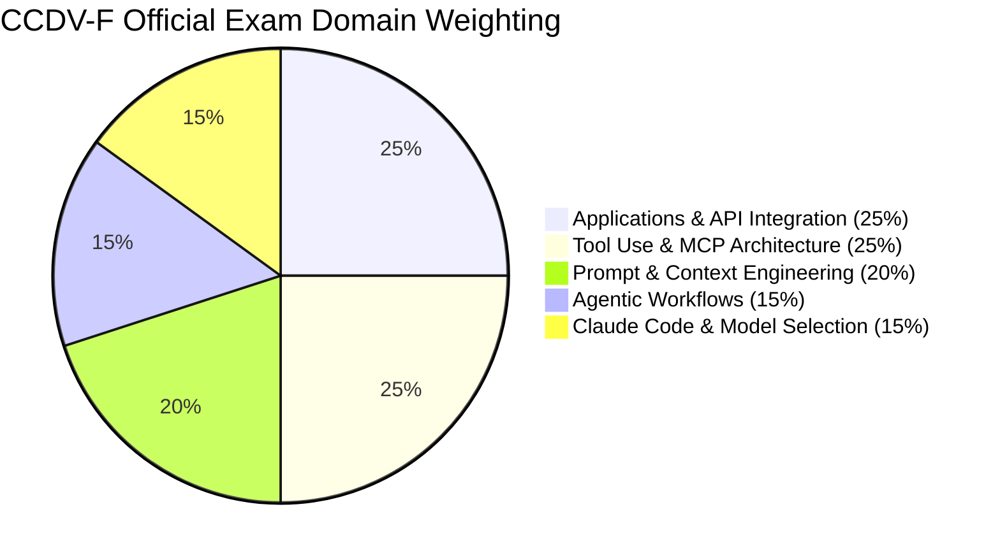

# Anthropic Claude Certified Developer - Foundations (CCDV-F) Study Guide

Welcome to the comprehensive, community-driven study repository for the **Anthropic Claude Certified Developer - Foundations (CCDV-F)** certification. This repository is built for software engineers, AI developers, and technical architects preparing to master the Anthropic Messages API, Tool Use (Function Calling), Model Context Protocol (MCP), prompt caching, and production deployment best practices.

Whether you are preparing for the official exam or looking to sharpen your production LLM engineering skills, this guide covers all core official exam domains with practical code patterns, architectural diagrams, and scenario-based exam preparation materials.

---

## Table of Contents

1. [Overview](#1-overview)
2. [About the Certification](#2-about-the-certification)
3. [Who Should Prepare for This Exam?](#3-who-should-prepare-for-this-exam)
4. [Official Exam Objectives & Domain Weighting](#4-official-exam-objectives--domain-weighting)
5. [Exam Domain Weightage Chart](#5-exam-domain-weightage-chart)
6. [Certification Preparation Flowchart](#6-certification-preparation-flowchart)
7. [Technical Architecture & Integration Diagram](#7-technical-architecture--integration-diagram)
8. [Circular Study and Revision Cycle](#8-circular-study-and-revision-cycle)
9. [Step-by-Step Preparation Roadmap](#9-step-by-step-preparation-roadmap)
10. [Core Technical Domains Deep Dive](#10-core-technical-domains-deep-dive)
11. [Practice Questions & Mock Testing Strategy](#11-practice-questions--mock-testing-strategy)
12. [Common Preparation Mistakes](#12-common-preparation-mistakes)
13. [Certification Benefits & Career Relevance](#13-certification-benefits--career-relevance)
14. [Frequently Asked Questions](#14-frequently-asked-questions)
15. [Official & Additional Learning Resources](#15-official--additional-learning-resources)
16. [About ExamsDay](#16-about-examsday)
17. [Disclaimer](#17-disclaimer)

---

## 1. Overview

The **CCDV-F** exam validates a developer's ability to build, integrate, test, and secure applications powered by Anthropic's Claude models. Unlike high-level conceptual AI credentials, the CCDV-F focuses heavily on programmatic implementations using the Messages API, deterministic JSON Schema tool calling, prompt caching, agentic loops, and Model Context Protocol (MCP) servers.

To validate your readiness under real exam time limits with scenario-based practice questions, visit the [ExamsDay CCDV-F Preparation Hub](https://examsday.com/exams/anthropic/ccdv-f).

---

## 2. About the Certification

* **Exam Code:** CCDV-F
* **Official Exam Name:** Claude Certified Developer - Foundations
* **Certification Provider:** Anthropic
* **Total Questions:** 53 to 60 multiple-choice and scenario-based questions
* **Exam Duration:** 120 minutes (2 hours)
* **Passing Score:** 720 / 1000 (72%)
* **Exam Fee:** $125 USD
* **Validity Period:** 12 months (annual recertification via non-proctored partner assessment)
* **Delivery Method:** Online proctored or Pearson VUE test center
* **Official Practice Exam Simulator:** [ExamsDay CCDV-F Practice Test Simulator](https://examsday.com/exams/anthropic/ccdv-f)

---

## 3. Who Should Prepare for This Exam?

This certification is designed for software practitioners building real-world AI applications:

* **Backend & Full-Stack Developers:** Engineers integrating Anthropic SDKs (Python and TypeScript) into existing web services, APIs, and microservices.
* **AI Application Engineers:** Developers building agentic workflows, Retrieval-Augmented Generation (RAG) pipelines, and autonomous tooling with Claude.
* **DevOps & Platform Engineers:** Specialists deploying AI developer tools, headless terminal automation scripts, and continuous integration workflows with Claude Code CLI.
* **Software Architects:** Leaders evaluating latency, cost optimization, context caching, and security boundaries across LLM infrastructures.

---

## 4. Official Exam Objectives & Domain Weighting

The CCDV-F blueprint tests knowledge across five foundational technical domains:

| Domain | Focus Area | Weighting |
| :---: | :--- | :---: |
| **Domain 1** | Applications & Anthropic API Integration | 25% |
| **Domain 2** | Tool Use & Model Context Protocol (MCP) | 25% |
| **Domain 3** | Prompt & Context Engineering | 20% |
| **Domain 4** | Agentic Workflows & Multi-Agent Topologies | 15% |
| **Domain 5** | Claude Code, Testing & Model Selection | 15% |

### Domain Breakdown Details

* **Domain 1: Applications & Anthropic API Integration (25%)**
  * Invoking `/v1/messages` endpoint with required and optional parameters (`model`, `max_tokens`, `system`, `temperature`, `stop_sequences`).
  * Consuming Server-Sent Events (SSE) streaming responses in Python and TypeScript.
  * Handling API error status codes: Rate limits (`429`), Overloaded capacity (`529`), Invalid request format (`400`), and Unauthorized keys (`401`).
  * Token inspection, pricing mechanics, and structured output parsing.

* **Domain 2: Tool Use & Model Context Protocol (MCP) (25%)**
  * Authoring robust function schemas using JSON Schema specification.
  * Executing client-side functions upon receiving `stop_reason: "tool_use"`.
  * Passing `tool_result` content blocks back into the conversational thread.
  * Architecture of Model Context Protocol: MCP Host, MCP Client, and MCP Server.
  * Implementing local `stdio` and remote `sse` MCP transport protocols.

* **Domain 3: Prompt & Context Engineering (20%)**
  * Semantic boundaries with XML tags (`<system_instructions>`, `<rules>`, `<documents>`, `<context>`).
  * Implementing Anthropic Ephemeral Prompt Caching (`cache_control: {"type": "ephemeral"}`).
  * Managing cache breakpoints, prefix invalidation rules, and TTL constraints.
  * Long-context optimization strategies (200,000 tokens) and prompt injection mitigation.

* **Domain 4: Agentic Workflows & Multi-Agent Topologies (15%)**
  * Constructing ReAct (Reasoning + Acting) loops for iterative task execution.
  * Orchestrator-worker patterns, routing networks, and evaluator-optimizer feedback cycles.
  * Implementing human-in-the-loop validation for destructive, sensitive, or high-impact actions.
  * Error recovery, tool timeouts, and dynamic retry loops.

* **Domain 5: Claude Code, Testing & Model Selection (15%)**
  * Selecting optimal models based on latency and cost: Claude 3.5 Haiku vs. Claude 3.5 Sonnet vs. Claude 3 Opus.
  * Configuring project-level agent rules and commands using `CLAUDE.md`.
  * Evaluation methodologies: benchmark dataset construction, LLM-as-a-judge testing, and deterministic assertions.

---

## 5. Exam Domain Weightage Chart



---

## 6. Certification Preparation Flowchart

```mermaid
flowchart TD
    Start([Start CCDV-F Preparation]) --> ReadBlueprint[Review Official Exam Objectives]
    ReadBlueprint --> SetupSDK[Set Up Anthropic Python / TypeScript SDK]
    SetupSDK --> CoreStudies[Study Messages API, Tool Calling & Prompt Caching]
    CoreStudies --> HandsOnLabs[Complete Hands-on Labs: Build Custom MCP Server & Tool Loop]
    HandsOnLabs --> PracticeQuestions[Take Domain Practice Questions]
    PracticeQuestions --> FullMock[Take Full-Length Timed Mock on ExamsDay]
    FullMock --> CheckScore{"Score >= 75%?"}
    CheckScore -- No --> GapAnalysis[Analyze Weak Domains & Review Error Logs]
    GapAnalysis --> RefactorCode[Refactor Lab Code & Re-read Anthropic Docs]
    RefactorCode --> PracticeQuestions
    CheckScore -- Yes --> FinalReview[Final Review of Rate Limits, Caching & Pricing]
    FinalReview --> SitExam([Sit for CCDV-F Exam at Pearson VUE])

## 7. Technical Architecture & Integration Diagram

```markdown
```mermaid
flowchart LR
    subgraph ClientEnvironment [Client Application Runtime]
        UserApp["Application Code (Python / TS)"]
        ClaudeCLI["Claude Code CLI Engine"]
        MCPClientInstance["MCP Client / Host"]
    end

    subgraph AnthropicPlatform [Anthropic Cloud Platform]
        APIGateway["Anthropic Messages API (/v1/messages)"]
        ContextCache[("Ephemeral Prompt Cache")]
        ClaudeEngine["Claude 3.5 Sonnet / Haiku Model"]
    end

    subgraph EnterpriseBackends [Model Context Protocol MCP Network]
        MCPServerSQL[("Database MCP Server (PostgreSQL)")]
        MCPServerFiles[("Local FileSystem MCP Server")]
        MCPServerExternal["Enterprise REST API MCP Server"]
    end

    UserApp -->|"1. API Request + System Instructions"| APIGateway
    ClaudeCLI -->|"Project Rules (CLAUDE.md)"| APIGateway

    APIGateway <-->|"Prefix Lookup / Store"| ContextCache
    APIGateway -->|"Execute Inference"| ClaudeEngine

    ClaudeEngine -->|"2. Return stop_reason: tool_use"| APIGateway
    APIGateway -->|"3. Forward Tool Call Payload"| UserApp

    UserApp -->|"4. Dispatch to MCP Client"| MCPClientInstance
    MCPClientInstance <-->|"stdio / SSE Transport"| MCPServerSQL
    MCPClientInstance <-->|"stdio / SSE Transport"| MCPServerFiles
    MCPClientInstance <-->|"stdio / SSE Transport"| MCPServerExternal

    MCPClientInstance -->|"5. Return tool_result"| UserApp
    UserApp -->|"6. Send Messages payload with tool_result"| APIGateway

## 8. Circular Study and Revision Cycle

Preparation for technical AI engineering is an iterative development loop:

---

#### Fix for Section 8: Circular Study and Revision Cycle

*(Switching to a clean `flowchart TD` loop is significantly more stable and consistent across GitHub dark and light themes than `stateDiagram-v2`)*:

```markdown
```mermaid
flowchart TD
    A([Start Cycle]) --> B[Study Concepts: Messages API & Tool Schemas]
    B --> C[Hands-On Coding: Implement Schemas & Execution Loops]
    C --> D[Practice Tests: Run ExamsDay Mock Test Simulator]
    D --> E[Error Analysis: Trace Failed Decisions & Cache Misses]
    E --> F[Targeted Revision: Review Official Anthropic Documentation]
    F --> G[Hands-On Refactor: Debug & Refactor Implementations]
    G --> H{Scoring >= 80% Consistently?}
    H -- No --> C
    H -- Yes --> I([Ready for Exam])

## 9. Step-by-Step Preparation Roadmap

```mermaid
gantt
    title CCDV-F 4-Week Study & Preparation Schedule
    dateFormat  YYYY-MM-DD
    section Week 1: Core API & SDKs
    Messages API Endpoints & Request Schema        :w1_1, 2026-11-01, 3d
    Streaming Responses, SSE & Token Usage         :w1_2, after w1_1, 4d
    section Week 2: Context & Caching
    XML Tagging, Delimiters & Few-Shot Prompts     :w2_1, 2026-11-08, 3d
    Prompt Caching Configuration & Token Limits    :w2_2, after w2_1, 4d
    section Week 3: Tools & MCP
    JSON Schema Tool Definitions & Execution Loop  :w3_1, 2026-11-15, 4d
    MCP Host, Client & Server Architecture         :w3_2, after w3_1, 3d
    section Week 4: Agents, CLI & Mocks
    Claude Code CLI Configuration & Multi-Agent    :w4_1, 2026-11-22, 3d
    ExamsDay Full Mock Exams & Error Remediation   :w4_2, after w4_1, 4d
```

### Week 1: Core API & SDK Fundamentals
* Install and configure `@anthropic-ai/sdk` (TypeScript) and `anthropic` (Python).
* Practice making structured calls to `/v1/messages` using `max_tokens`, `system`, and custom stop sequences.
* Handle streaming text responses in real-time using `stream()` helper methods.
* Implement robust client-side error handling for HTTP `400`, `401`, `429`, and `529`.

### Week 2: Prompt Engineering & Prompt Caching
* Structure system prompts using semantic XML tags (`<context>`, `<guidelines>`, `<data>`).
* Configure prompt caching using `cache_control: {"type": "ephemeral"}` on large static documents.
* Inspect response usage headers: `cache_creation_input_tokens` and `cache_read_input_tokens`.
* Review prefix-matching rules and cache breakpoint limits.

### Week 3: Tool Use & Model Context Protocol (MCP)
* Author tool definitions using valid JSON Schema specifications with descriptive parameter fields.
* Write a complete tool execution loop: process `stop_reason: "tool_use"`, invoke local functions, and return `tool_result` content blocks.
* Build a local MCP Server using `stdio` transport and connect it to an MCP Host.

### Week 4: Agentic Topologies, Claude Code & Final Practice
* Build ReAct agent loops with multi-turn conversation memory.
* Set up `CLAUDE.md` to define project context, test suites, and terminal workflows for Claude Code CLI.
* Take timed practice tests on [ExamsDay](https://examsday.com/exams/anthropic/ccdv-f) to simulate real test conditions and review detailed answer explanations.

---

---

## 10. Practice Questions & Mock Testing Strategy

To prepare effectively:
* Practice identifying the root architectural requirement before reading the answer choices.
* Map every practice test mistake back to the official domain objectives.
* Treat practice tests as diagnostic tools rather than memorization drills.

### Sample Scenario 1: Prefix Invalidation in Prompt Caching

**Scenario:**  
You are designing a customer support bot with a static 40,000-token product manual cached using `"cache_control": {"type": "ephemeral"}`. The manual is placed in the `system` parameter block. On conversational turn 3, your application prepends a dynamic user timestamp string to the very start of the `system` parameter before the manual.

What will happen to the prompt cache on turn 3?

* **A)** The cache will read successfully because the manual text itself did not change.
* **B)** A cache miss will occur (`cache_read_input_tokens: 0`) because Anthropic prompt caching requires an exact character-for-character prefix match from the start of the request.
* **C)** Claude will automatically update the cache index and process the prompt at a 50% discount.
* **D)** The Messages API will return an HTTP 400 Bad Request error.

<details>
<summary><b>View Answer & Explanation</b></summary>

**Correct Answer:** **B**

**Explanation:**  
Anthropic's Prompt Caching strictly uses prefix matching starting from the first character of the request. Modifying anything that precedes the cached block—including inserting a dynamic timestamp at the beginning of the system prompt—alters the prompt prefix, causing an immediate cache miss and incurring full token creation costs.
</details>

---

### Sample Scenario 2: Enforcing Deterministic JSON Outputs

**Scenario:**  
Your backend service needs Claude to extract invoice details into structured JSON matching this schema: `{"vendor": str, "total_amount": float, "invoice_id": str}`. You must ensure the response contains no conversational markdown or introductory text.

What is the recommended implementation pattern?

* **A)** Append *"Return only JSON, no markdown backticks, no conversational filler"* to the user prompt.
* **B)** Define a tool representing the schema (e.g., `record_invoice_details`) and set `tool_choice: {"type": "tool", "name": "record_invoice_details"}`.
* **C)** Set `response_format: {"type": "json_object"}` in the API request.
* **D)** Run a post-processing regex on the client application to clean the string.

<details>
<summary><b>View Answer & Explanation</b></summary>

**Correct Answer:** **B**

**Explanation:**  
The Anthropic Messages API enforces deterministic structured outputs through forced tool use. By defining a tool that reflects the required schema and setting `tool_choice: {"type": "tool", "name": "..."}`, Claude is forced to generate a structured `tool_use` content block without introductory or concluding conversational text.

*Option C is incorrect because `response_format` is an OpenAI API parameter, not supported in Anthropic's Messages API.*
</details>

For more scenario-based mock exams, visit the [ExamsDay CCDV-F Module](https://examsday.com/exams/anthropic/ccdv-f).

---

## 11. Common Preparation Mistakes

* **Assuming Server-Side Execution for Tools:** Claude never executes functions on Anthropic servers. Claude only returns JSON parameters; execution takes place inside your client environment or MCP Server.
* **Invalidating Prompt Caching Prefixes:** Modifying system prompts, tools, or message history prior to a cached breakpoint triggers a cache miss, leading to higher latency and unexpected token costs.
* **Using Claude 3 Opus for Simple Classification:** Claude 3 Opus has higher latency and cost. For simple extraction, classification, and high-frequency routing, Claude 3.5 Haiku is the recommended choice.
* **Omitting XML Structural Delimiters:** Omitting XML tags (`<rules>`, `<context>`, `<input>`) increases prompt injection vulnerability and reduces instruction following accuracy in complex prompts.
* **Confusing HTTP Status Codes:** Conflating `429` (client rate limit) with `529` (Anthropic platform overload). Both require backoff, but `529` represents temporary infrastructure congestion rather than account quota exhaustion.

---

## 12. Certification Benefits & Career Relevance

* **Verified Production Expertise:** Demonstrates proficiency in production LLM development beyond simple prompt generation.
* **Enterprise Architectural Readiness:** Confirms your ability to build production systems that balance token economics, latency, and context caching.
* **MCP & Tooling Standards:** Demonstrates hands-on competency with the Model Context Protocol (MCP) and Claude Code CLI workflows.
* **Career Growth:** Validates specialized engineering capabilities for AI Engineer, Solutions Architect, and Full-Stack AI Developer roles.

---

## 13. Frequently Asked Questions

### What happens if I fail the CCDV-F exam?
Anthropic's retake policy typically requires a 14-day waiting period before a second attempt. Use your score report to target weak domains with hands-on practice before scheduling a retake.

### Does the exam involve live coding in an IDE?
The exam is delivered via Pearson VUE and uses multiple-choice, multiple-response, and scenario-based code analysis questions rather than an active terminal IDE. However, questions frequently include realistic code snippets that require identifying bugs, SDK misconfigurations, and schema errors.

### How does Prompt Caching impact pricing and latency?
Prompt Caching offers up to a 90% discount on cached input tokens and reduces Time to First Token (TTFT) by up to 80% for long prompts, making it a critical topic on the exam.

---

## 14. Official & Additional Learning Resources

### Official Documentation
* [Anthropic Messages API Reference](https://docs.anthropic.com/en/api/getting-started)
* [Anthropic Prompt Engineering Tutorial](https://github.com/anthropics/prompt-eng-interactive-tutorial)
* [Model Context Protocol (MCP) Official Specification](https://modelcontextprotocol.io/)
* [Anthropic Prompt Caching Guide](https://docs.anthropic.com/en/docs/build-with-claude/prompt-caching)
* [Claude Code Documentation](https://docs.anthropic.com/en/docs/agents-and-tools/claude-code)

### Practice & Assessment
* [ExamsDay CCDV-F Practice Test Simulator](https://examsday.com/exams/anthropic/ccdv-f): Timed mock tests, domain-level skill assessments, and scenario questions.
* [ExamsDay IT Certification Directory](https://examsday.com/): Comprehensive practice resources across cloud and AI certification tracks.

---

## 15. About ExamsDay

[ExamsDay](https://examsday.com/) is an official platform providing IT certification preparation materials, mock exams, and structured technical study resources.

ExamsDay resources emphasize real-world problem-solving, architectural decision-making, and deep scenario analysis. Utilizing practice tests alongside hands-on SDK experimentation ensures you understand not just which answer is correct, but the architectural trade-offs that make it optimal in production environments.
